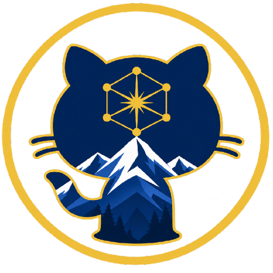
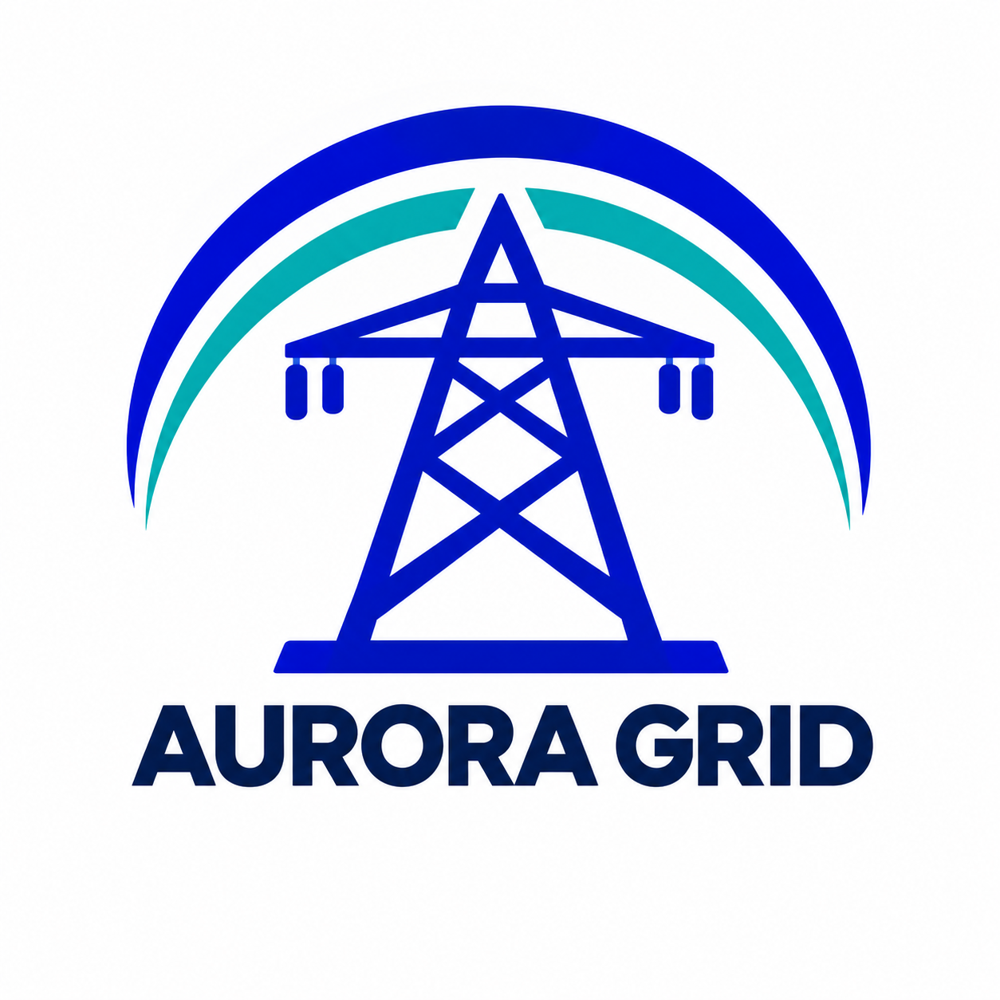

  &nbsp;&nbsp;&nbsp;&nbsp;
  

# NIS2 Case Study — Design an AI-assisted compliance assessment

**FusionAI Academy · NIS2 workshop**

## You are the consulting team

Aurora Grid operates an electricity network. The company wants to understand whether its cybersecurity practices meet the requirements it must follow, and how AI could help with that assessment.

Your team has been asked to **design a methodology and explain why it would work**. You have a questionnaire, company records, cybersecurity requirements and technical guidance. How would you use these materials to reach conclusions that the client can understand and trust?

Aurora is a fictional company. For the exercise, treat it as an Italian NIS2 essential entity.

## What you will practise

- Turn a client's question into a clear assessment problem.
- Make and justify design choices using real source material.
- Decide where AI can help and where human judgment matters.
- Explain how you would check the quality of the results.
- Recognise uncertainty and communicate the limits of your approach.

## Your materials

| Material | Start here to understand… |
| --- | --- |
| [Security questionnaire](../inputs/security-questionnaire.md) | The ten questions asked about the company's cybersecurity practices and the possible answers. |
| [Aurora Grid dossier](../inputs/aurora-grid-dossier.md) | Aurora's answers and the company records available for your analysis. |
| [ACN requirements](../inputs/acn-essential-entity-requirements.xlsx) | The requirements to assess, organised into measures and numbered points. Open the `Security Measures` sheet. |
| [ENISA technical guidance](../inputs/enisa-technical-guidance.pdf) | Technical explanations and guidance. This is non-binding guidance, not evidence of what Aurora does. |

All materials are supplied in English. Readable versions of the questionnaire and dossier are linked above; JSON copies are also available in `inputs/`. You only need a document reader and a spreadsheet viewer to take part.

## The challenge

Study the case and propose an approach that could support an assessment of Aurora. Choose how to organise the work, use the materials and present the results. Explain the reasoning behind your choices.

Use **one small example of your choice** to make your proposal concrete. Show enough of your reasoning for another team to understand and question it. You are designing a method for the wider case; you do not need to assess every requirement during the workshop.

**No coding is required.** Spend your time understanding the problem, discussing alternatives and developing a proposal you can defend.

## Your deliverable

Submit **one report per team**, using the [report template](../SUBMISSION_TEMPLATE.md) as a guide. Aim for **4–6 pages**, in PDF or Markdown, covering:

1. **The problem:** what you want to assess and the assumptions you make.
2. **Your approach:** how it would work and why you chose it. A diagram can help.
3. **An example:** a short walkthrough grounded in the supplied materials.
4. **Your checks:** how you would test the method and recognise unreliable conclusions.
5. **Your advice to the client:** what your approach would deliver, its limits and the questions still open.

Include the team members' names. Name the file `team-<name>-nis2-methodology.pdf` or `.md` and use the submission channel announced by the instructor.

## What makes a strong proposal?

A strong proposal is clear enough to follow, explains its choices and can be challenged against the sources. It acknowledges what it cannot establish. We will discuss the quality of your reasoning, the feasibility of your approach and the usefulness of your checks.

For your example, make references easy to find: an ACN measure and point, a dossier record ID, a questionnaire question or an ENISA section and page. Explain what the source supports rather than simply listing it. Missing information is a reason to ask questions, not automatically proof that a requirement is unmet.

If you give an assessment judgment, use the vocabulary introduced in the briefing:

| Judgment | What you are saying |
| --- | --- |
| Satisfied | The information supports the requirement in full within the scope assessed. |
| Partially satisfied | Some parts are supported, but there is a material gap. |
| Not satisfied | The information shows that a material part of the requirement is unmet. |
| Not determinable | The available information does not support a decision. |

## During the workshop

You have **three hours**. The instructor acts as your client contact: ask about anything unclear and keep track of unanswered questions. You may use AI tools; be ready to explain what you used them for and how you checked their contribution.

In the afternoon, we will compare your proposals with a worked system and discuss the design choices together.

**Good luck, team!**

---

Original references: [ACN](https://www.acn.gov.it/portale/nis/modalita-specifiche-base) · [ENISA](https://www.enisa.europa.eu/sites/default/files/2025-06/ENISA_Technical_implementation_guidance_on_cybersecurity_risk_management_measures_version_1.0.pdf)
